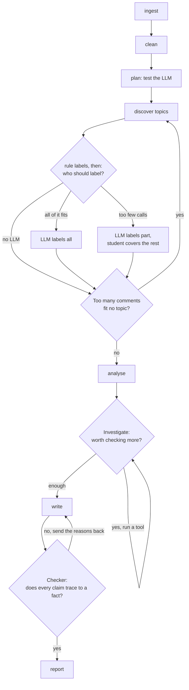

# Comment Insight Agent

An AI agent that reads a CSV or JSON file of social media comments about a product and writes a report whose claims trace back to the data: how customers feel and why, what they complain about and ask, and what the company should do first.

It runs three ways, with the same code: with no LLM at all, on a local model with no internet, or on a cloud API. No paid key is needed.

## Results

| Report | Data | Model and time |
| --- | --- | --- |
| [Full sample](output_sample/gemini_flash_lite/report.md) | 4,200 synthetic comments | Gemini 3.5 Flash-Lite on its free tier, 14.6 minutes |
| [Real product tweets](output_sample/gemini_sxsw_1000/report.md) | 1,000 public tweets about Apple and Google products, SXSW 2011 | Gemini 3.5 Flash-Lite, about 14 minutes |
| [Real airline tweets](output_sample/gemini_airline_1000/report.md) | 1,000 public tweets to US airlines, February 2015 | Gemini 3.5 Flash-Lite, about 7 minutes |
| [Local model](output_sample/ollama_qwen3_1500/report.md) | 1,500 synthetic comments | qwen3:4b on my laptop's CPU, about 3 hours |
| [No LLM](output_sample/rules_only/report.md) | 4,200 synthetic comments | Rules only, in seconds |

The [full HTML version of the first report](https://simonpanigrahi.github.io/comment-insight-agent/output_sample/gemini_flash_lite/report.html) has the charts and clickable evidence. Each folder also holds its `report.html` and `run_log.jsonl`, the audit trail.

The product tweets come from the week [the iPad 2 launched and Apple opened a pop-up store at SXSW](https://www.macrumors.com/2011/03/10/apple-to-open-pop-up-temporary-store-at-sxsw-for-ipad-2-launch/). With no hints, the agent found topics such as Apple store, iPad products and iPhone usage.

On 300 tweets labelled by people, Gemini's labels reached a macro-F1 of 0.816 on airline tweets and 0.673 on product tweets, against 0.573 and 0.462 for rules alone. qwen3:4b reached 0.754 on the airline tweets. In the whole-agent run on 1,000 product tweets, Gemini reached 0.666, against 0.482 for rules on the same tweets. The full table and its limits are under [Accuracy](#accuracy-measured-on-real-data).

## Try it in two minutes

Needs Python 3.10 or newer.

```bash
python3 -m venv .venv && source .venv/bin/activate
pip install -r requirements.txt
python run.py analyse data/sample_comments.csv --title "Kestrel One launch"
```

Then open `output/sample_comments/report.html`. A finished example is in `output_sample/`.

This first run uses rules only, so it finishes in seconds and its labels are rough. For better labels, add an LLM:

```bash
# On-premise: a local model, no internet needed once it is downloaded
ollama pull qwen3:4b
python run.py doctor --provider ollama
python run.py analyse data/sample_comments.csv --provider ollama --title "Kestrel One launch"

# Or a cloud API, for sample data only (copy .env.example to .env and put your key in it)
python run.py doctor --provider gemini --model gemini-3.5-flash-lite
python run.py analyse data/sample_comments.csv --provider gemini --model gemini-3.5-flash-lite --title "Kestrel One launch"
```

A local model has no cap on calls, so it labels every distinct comment and shows the time left. `doctor` gives a first estimate, and if it is slow, `python scripts/speed_test.py` shows whether the model is on the GPU and what to change. To shorten a run, use `--limit 1000` for a random sample of rows, or `--max-llm-calls 110` to label part of the file and let a small student model cover the rest. Cloud free tiers have daily limits, so their presets stop within them. If a run stops midway, the same command continues from the cache.

Use your own file the same way. Column names are detected, so a file with `text`, `tweet_text` or `message` all work. If detection fails, use `--text-col`.

## Test it yourself

**Your own comment.** After the install above, type any comment and see how it is read:

```bash
python scripts/try_comment.py "Wow, the phone lasted a whole 2 hours. Great job."
```

With no key, only the rules run. They are rough: they read this sarcastic comment as positive. For the LLM's sentiment, reason and quote, add a model. A [free Gemini key](https://aistudio.google.com/app/apikey) is the quickest, or use a local model:

```bash
cp .env.example .env    # then put your key after GEMINI_API_KEY= in .env
python scripts/try_comment.py "Wow, the phone lasted a whole 2 hours. Great job." --provider gemini --model gemini-3.5-flash-lite
python scripts/try_comment.py "Wow, the phone lasted a whole 2 hours. Great job." --provider ollama
```

Leave out the comment and it asks for comments one by one. Add `--topics "Delivery,Refunds"` to choose from your own topic names.

**Against labels written by people.** Compare a finished run with the human labels, and read where they differ:

```bash
python scripts/get_benchmarks.py
python scripts/compare_labels.py output_sample/gemini_airline_1000 benchmarks/data/airline.csv --label airline_sentiment --reason negativereason
```

## How each requirement is met

| Requirement | What the agent does |
| --- | --- |
| Data ingestion | Reads CSV, TSV, JSON, JSONL and nested JSON, in UTF-8 or older encodings. Detects which columns hold the text, id, platform, time and engagement, and repairs common faults such as unquoted commas. Clear errors for unusable files. |
| Sentiment and its reason | Labels each comment positive, negative or neutral, gives the reason, and quotes the exact words that show it. Code checks that the quote really is in the comment. |
| Topic and intent | Topics are discovered from the data, not assumed: TF-IDF and NMF find the groups and the LLM names them. Intent is complaint, question, praise, suggestion, purchase intent or other. |
| Agentic workflow | A LangGraph state machine that decides at run time, investigates with tools, and corrects itself. See below. |
| Intelligent report | Ranked actions with owners, safety and legal alerts, spikes with likely drivers, top reasons, FAQ candidates and feature requests. Every claim links to its evidence. |

## The agent



Every run saves its decisions in `run_log.jsonl` and lists them in the report, so you can see what it chose and why.

| Decision | What the agent observes | What it does |
| --- | --- | --- |
| Is the LLM usable? | A real test call at the start, then every reply | Uses it, or carries on with rules and says so. A server failure midway, or five failed batches in a row, keeps the labels so far. |
| Who labels which comment? | The call budget and the language of each comment | LLM for all if the budget allows, which is the default on a local model. If not: hard comments first, then a random sample, then whatever a small student model is least sure about. This is the path for free-tier quotas and for very large files. |
| Is the student good enough? | Macro-F1 of student and rules on held-out LLM labels, with at least 300 random labels | Uses whichever wins, separately for sentiment, intent and topic. |
| Is the topic list good enough? | The share of comments in "Other" | Above 15 percent, it goes back and finds new topics in those comments. |
| What should be checked next? | The facts so far | The LLM picks a tool (spike drivers, platform split, top quotes, more reasons, time trend, search) or stops. An unknown topic is rejected, and a spike must be looked into before it can stop. The log says who really chose. |
| Can this draft be trusted? | The code checker's result | Sends the exact problems and the draft back to the writer, at most twice. Anything still failing is removed, a failed headline is replaced with a fixed sentence, and the report counts what was removed. If too little survives, a fixed-sentence writer takes over. |

In the terms of Anthropic's [Building Effective Agents](https://www.anthropic.com/research/building-effective-agents), this uses routing, an evaluator-optimizer loop, and an LLM-directed tool loop. Tool choices are JSON validated by Pydantic rather than native function calling, because support for that varies across small local models.

## How far the report can be trusted

- **The LLM never calculates.** Code computes every number and turns it into a numbered fact. The LLM can only repeat facts.
- **The checker is code, not another LLM.** A check that can hallucinate is not a check. It confirms that each number, date and quote appears in the facts cited, and that a claim about a topic cites a fact about that topic. It also rejects dressed-up figures (5k, 3x, "tripled"), amounts of money, a percentage tied to the wrong sentiment, a rise described as a fall, and a cause stated as proven.
- **What the checker cannot do.** It cannot tell that a real fact was misread in a way its patterns do not cover, and it says nothing about whether each label is right. That is what the accuracy table below is for.
- **Each label must show its evidence.** The quote an LLM gives for a comment must really be in that comment. If it is not, after a second try, the label is kept but flagged for review.
- **Alerts do not rest on one model.** Rules scan every comment for common wordings of safety, legal and privacy reports on every run. The word lists are narrow, so they can miss unusual wordings. Each serious alert must get an action marked today, and if the writer omits one, it is added back. An LLM can add to the alert list, but it cannot take anything off. If it reads a rule hit as a false alarm, the report says so, and a person decides.
- **Comments are untrusted input.** Obvious prompt injection attempts are filtered before any model sees them, but a filter can be beaten. So the prompts also say to treat comments as data, and output must fit a schema. At worst a comment mislabels itself or its batch, and it cannot change how numbers are computed. A comment that looks like injection but also reports harm stays in the report for people, and is held away from the LLM.
- **Personal data is masked.** Long numbers such as phones and card or ID numbers, PAN numbers and emails are masked before any model sees the text, and the output files hold only the masked text. Names and street addresses are not masked.

## Accuracy, measured on real data

Measured with `scripts/evaluate.py` on public tweets labelled by humans. Metrics on the synthetic sample would mean little, because its answers were written along with it.

| Method | Airline tweets (14,640), accuracy / macro-F1 | SXSW product tweets (8,936), accuracy / macro-F1 |
| --- | --- | --- |
| Always guess the commonest class | 0.627 / 0.257 | 0.603 / 0.251 |
| Plain VADER on raw text | 0.490 / 0.457 | 0.533 / 0.460 |
| Plain VADER on cleaned text | 0.549 / 0.513 | 0.533 / 0.460 |
| Classifier trained on the other dataset | 0.418 / 0.414 | 0.493 / 0.392 |
| This project's rules | 0.612 / 0.573 | 0.534 / 0.462 |
| Student, 300 labels | 0.652 / 0.557 | 0.565 / 0.444 |
| Student, 600 labels | 0.694 / 0.611 | 0.576 / 0.465 |
| Student, 1,200 labels | 0.719 / 0.640 | 0.594 / 0.493 |
| Student, 2,400 labels | 0.750 / 0.676 | 0.638 / 0.532 |
| Gemini 3.5 Flash-Lite, on 300 random tweets | 0.837 / 0.816 | 0.720 / 0.673 |
| qwen3:4b on a laptop CPU, on the same 300 tweets | 0.787 / 0.754 | not run |

How to read this:

- The two LLM rows use 300 random tweets from each set, so each accuracy could be about 5 points higher or lower, and the gap between the two models is close to that. The other rows use the full sets. On the same 300 tweets the rules score 0.623 / 0.582 on airline and 0.497 / 0.448 on SXSW, so the comparison holds.
- In the whole-agent run on 1,000 SXSW tweets, Gemini's labels scored 0.750 / 0.666 against people on the 983 with a clear human label, close to the 300-tweet result. Rules score 0.561 / 0.482 on those same tweets. Only 6 of the 983 were positive read as negative or the reverse. Most disagreements are over where neutral begins: of the 338 tweets people called positive, the agent called 143 neutral. Some of those human labels look generous and some of the agent's calls look wrong, so `scripts/compare_labels.py` prints them to read.
- VADER, a popular rule-based tool, and this project's rules all score below always guessing the commonest class on accuracy, on both datasets. Their macro-F1 is higher because they do find the small classes. So rules are only the fallback here, and a rules-only report says so at the top.
- The rule words were adjusted while looking at the airline data, so the rules row is a little optimistic.
- The student rows use human labels as the teacher, so they are an upper limit for what an LLM teacher could give at that size.
- A classifier trained on one dataset does worse than the rules on the other, so a classifier cannot simply be shipped ready-trained. It must learn from each new dataset, and that is what the student does.
- On SXSW, "no emotion toward a brand" is treated as neutral, which is only approximately the same thing.

**What a call budget buys.** In a one-off simulation that is not part of this repository, a fake LLM acted as a perfect teacher: it answered with the human label, at 12 comments per call, and the student was scored on every usable comment. At 110 calls the student could not beat the rules, so the result stays low (0.646 / 0.606 on airline, 0.599 / 0.524 on SXSW). At 300 calls it reached 0.856 / 0.816 and 0.802 / 0.744, and at 1,000 calls 0.991 / 0.986 on airline. A real LLM will do worse than these, because it makes mistakes and the student copies them.

`python scripts/evaluate.py --mode gold --run <output folder>` scores a finished run of the sample by hard slice. On the 1,441 usable comments of the 1,500-row run, rules score 0.060 on the planted sarcasm, 0.806 on Hinglish and 0.778 on Indian scripts, and qwen3:4b scores 0.500, 0.971 and 0.972. On the full sample, Gemini scores 1.000, 0.997 and 1.000. Scores that high show the planted cases are too easy, not that these problems are solved: the 130 sarcastic comments are only 16 phrasings, and the same model reaches 0.837 on real airline tweets. That data was written for this project, so this shows which slices a mode can read, not real-world accuracy. Real sarcasm, Hinglish and Hindi have not been measured.

**Why an LLM cannot remove an alert.** In that same run, qwen3:4b read 10 of the 22 planted safety, legal and privacy reports as not urgent, including 4 of the 14 safety reports. All 22 stayed on the alert list, marked as doubted, for a person to read. On the full sample, Gemini doubted 5 of the 61, all of them legal.

**A real-data check of the spike finder.** On the airline tweets, with no LLM, the agent reports that complaints about cancellations rose 3.6 times from 21 February 2015, with "dfw", "dallas", "rebook" and "hrs" becoming far more common. It knows nothing about the outside world, but [an ice storm cancelled about 1,100 flights at DFW on 23 February 2015](https://www.reviewjournal.com/?p=181387). On a random 1,000 of these tweets, with Gemini, it flags negative comments rising in 6 topics, including flight cancellations and hold times, from about 22 February, and says a wider event may be behind this. The agent shows an association. The news link was found separately, after the run.

## Choices and what was rejected

| Question | Choice | Why, and what was rejected |
| --- | --- | --- |
| Rules, LLM or both? | LLM first, with a student and rules behind it | LLM on everything is the default, and only costs time on a local model. Free-tier quotas and very large files need the student. Rules alone are too weak (see table). |
| Agent framework | LangGraph | Loops, conditional edges and shared state are what this needs. Plain Python would work too, but hides the graph. Role-based frameworks add less control. |
| LLM access | Plain HTTP to Ollama or any OpenAI-compatible server | The same code runs on-premise or in the cloud, with no vendor lock-in. |
| Topic discovery | TF-IDF and NMF, named by the LLM | Cheap, works offline and at any size, and needs no model download. A fixed topic list cannot work on an unknown product. |
| Report writer check | Deterministic code | Repeatable and testable. It cannot catch a claim that cites a real fact but misreads it. |

## What comes out

| File in the output folder | What it is |
| --- | --- |
| `report.html` | The report, one self-contained file that works offline |
| `report.md` | The same findings as text |
| `labelled_comments.csv` | Every comment with its label, reason, evidence, source and review flag (masked text only) |
| `insights.json` | Findings, actions and facts for other systems to use |
| `run_log.jsonl` | The audit trail: every decision and LLM call with timing and tokens |
| `graph.mmd` | The agent's graph, generated from the code |

You can also question a finished run. This is a small retrieval-based chatbot that answers only from the comments, cites them, and refuses when they do not answer:

```bash
python run.py ask output/sample_comments "what do people say about the warranty?" --provider ollama
```

## Limitations

- The local model path depends on your hardware. Speed and label quality must be measured on your machine with `doctor` and `evaluate.py`. On my laptop's CPU, with its GPU driver not working, qwen3:4b wrote about 12 tokens per second, and 1,500 rows took about 3 hours. The full 4,200-row sample would take at least 5.
- A small local model is weaker at judgement than at labelling. In the 1,500-row run, the checker rejected all three of its drafts for stating a cause as proven, so code replaced the headline and removed 2 statements. The report counts the 2 statements but does not mention the headline.
- Sarcasm is not settled. qwen3:4b read half of the planted sarcasm correctly and Gemini read all of it, but those are only 16 simple phrasings, and real sarcasm has not been measured.
- A label's reason is the model's own summary and is not checked. Only its evidence quote is. Reasons with different wording are counted separately.
- The sample data is synthetic. It tests the system end to end, not real-world accuracy.
- A spike's "drivers" are words that became more common at the same time. That shows an association, not a cause.
- A spike counts complaints per day, not their share of all comments, so a rise in total volume lifts every topic. In the 1,000 airline tweets, the busiest day had about 3 times the usual number of tweets. If 4 or more topics rise together, the report says a wider event may be behind it, as it did there.
- Only the 3 largest spikes can be looked into. So a decisions list can say "No spike was found" for a topic whose spike is in the report, as the airline report does for flight cancellations. The spike figures are right, and this is a small bug in the investigation tool.
- On real tweets, the common questions and feature requests lists pick up noise, so a person should review them.
- Exact duplicates are merged, but near duplicates are not.
- The impact score is a simple ranking aid, not a validated measure.
- Rules read very little sarcasm and few Indian languages, so a rules-only report carries a warning.
- Alert rules use narrow word lists, so they can miss unusual wordings of a real report.
- A comment with only emoji has no letters, so it counts as having no content.
- Language tags come from the script and a Hindi-English word list, so they are approximate.
- Names and street addresses are not masked.

## How this could feed an on-premise support chatbot

| This project | The chatbot need it maps to |
| --- | --- |
| Intent and topic labels | Understanding what a user wants, and routing it |
| Common questions | Seeding the FAQ knowledge base |
| Rule-based safety alerts on top of an LLM | Priority routing for urgent messages |
| Facts, citations and the code checker | Limiting hallucination |
| Local model, plain HTTP, context limits | Working on-premise with no internet |
| Run log, cost and timing | Audit logs and LLMOps |
| `ask` command | The basic grounded chat loop |

## Tests

```bash
pytest
```

225 tests. They use a fake LLM server (`tests/fake_llm.py`) to check everything around the model with no network or GPU: retries, rate limits, invalid and cut-off replies, invented quotes and numbers, the checker loop, the topic loop, the student path, a model that cannot label, the server dying midway, and safe output. They do not measure how good a real model is.

## Project layout

```text
run.py                 command line: analyse, doctor, ask
agent/graph.py         the agent: nodes, edges and decisions. Start reading here.
agent/config.py        providers, models and budgets
agent/ingest.py        read files, detect columns
agent/clean.py         mask personal data, flag spam and injection, tag language, merge repeats
agent/topics.py        discover topics
agent/classify.py      route comments to the LLM, student or rules
agent/rules.py         the offline fallback and the safety rules
agent/llm.py           LLM client: budget, retries, cache, validation
agent/prompts.py       every prompt
agent/schemas.py       the required shape of every LLM reply
agent/analyse.py       all the counting, the facts, and the investigation tools
agent/insights.py      choose checks, write findings, verify them
agent/report.py        HTML, Markdown, CSV and JSON output
agent/ask.py           question answering over a finished run
agent/runlog.py        the audit trail
scripts/               sample data, benchmark download, evaluation, speed test, try one comment, compare with human labels
```

## Data

`data/sample_comments.csv` is synthetic: the Kestrel One, its company and its comments are made up. It has planted patterns (a battery spike after an update, rare safety reports, sarcasm, Hinglish, Hindi, Odia, spam, injection attempts). `scripts/make_sample_data.py` rebuilds it.

The benchmarks are the CrowdFlower "Twitter US Airline Sentiment" and "Brands and Product Emotions" datasets, downloaded from public mirrors by `scripts/get_benchmarks.py` and not stored here, apart from the tweets in the sample reports under `output_sample/`. The airline tweets are about a service rather than a product, so the SXSW tweets about Apple and Google products are the closer match to the task. The airline set adds human reasons for its negative tweets, which `scripts/compare_labels.py` can show. See the original publishers for their terms.

## Development note

I built this in about a day with Claude as an AI coding assistant. I ran the LLM results reported here on my own laptop, re-ran the baseline tables, read the reports, and went through the code so that I can explain it and change it.
